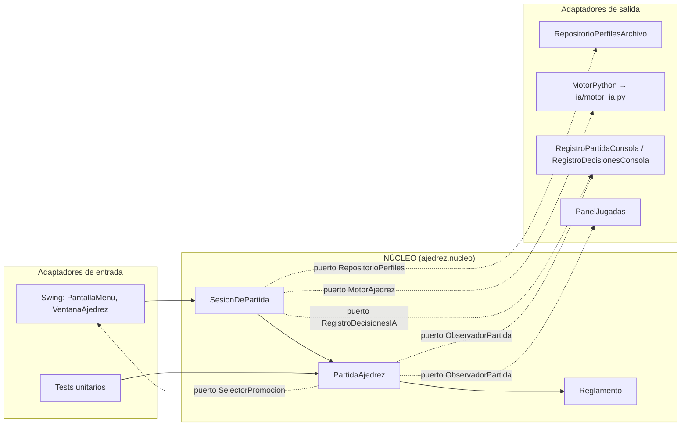
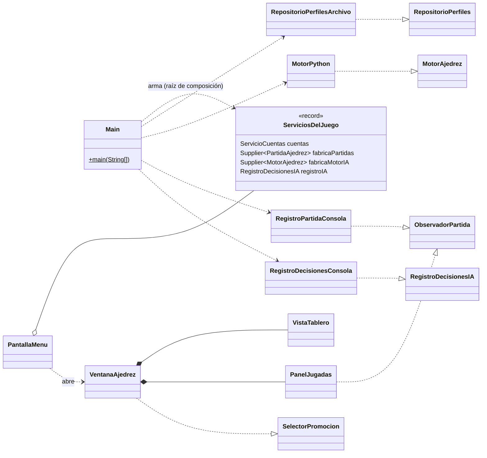

# Arquitectura

El sistema sigue la arquitectura hexagonal (puertos y adaptadores): el núcleo está
en el centro y **todas las dependencias apuntan hacia adentro**. El paquete `ajedrez.nucleo` no importa
nada de `ajedrez.adaptadores`, ni de Swing, ni de `java.io` para persistir: eso se comprueba compilando
el núcleo solo (`correr_tests.bat` lo compila y lo prueba sin levantar ninguna ventana).

## Vista general

Las flechas punteadas son **puertos de salida**: interfaces que define el núcleo y que los adaptadores
implementan. El núcleo nunca nombra a la clase concreta que hay del otro lado.

## Puertos

| Puerto | Tipo | Quién lo implementa hoy |
|---|---|---|
| `PartidaAjedrez`, `SesionDePartida`, `ServicioCuentas` | entrada (driving) | la ventana Swing y los tests los llaman |
| `SelectorPromocion` | salida | `VentanaAjedrez` (diálogo), `SIEMPRE_REINA` (IA y tests) |
| `ObservadorPartida` | salida (Observer) | `PanelJugadas`, `RegistroPartidaConsola`, mocks en tests |
| `RepositorioPerfiles` | salida | `RepositorioPerfilesArchivo`; un fake en memoria en los tests |
| `MotorAjedrez` | salida | `MotorPython`; stubs en los tests |
| `RegistroDecisionesIA` | salida | `RegistroDecisionesConsola`; un mock en los tests |
| `DisposicionInicial`, `ReglaDeTablas`, `EstrategiaMovimiento` | extensión (Strategy) | implementaciones del núcleo; lambdas en los tests |

## Diagrama de clases del núcleo

```mermaid
classDiagram
    direction TB

    class PartidaAjedrez {
        -Tablero tablero
        -DisposicionInicial disposicion
        -Reglamento reglamento
        -SelectorPromocion selectorPromocion
        -HistorialComandos historialComandos
        -HistorialPosiciones historialPosiciones
        -EstadoPartida estadoActual
        -List~ObservadorPartida~ observadores
        +estandar()$ PartidaAjedrez
        +intentarMover(Jugada) EventoJugada
        +deshacerMovimiento() boolean
        +rehacerMovimiento() boolean
        +obtenerJugadasLegales(Color) List~Jugada~
        +agregarObservador(ObservadorPartida)
        +quitarObservador(ObservadorPartida)
    }

    class SesionDePartida {
        -PartidaAjedrez partida
        -Color colorJugador
        -PerfilJugador perfil
        -ServicioCuentas cuentas
        -ConfiguracionIA ia
        +mover(Jugada) ResultadoJugada
        +calcularJugadaIA() DecisionIA
        +deshacer() boolean
        +rehacer() boolean
    }

    class Reglamento {
        -FabricaPiezas fabricaPiezas
        -FabricaComandos fabricaComandos
        -ValidadorMovimiento validador
        -List~ReglaDeTablas~ reglasDeTablas
        +estandar()$ Reglamento
    }

    class Tablero {
        -int filas
        -int columnas
        -Map~Posicion,Pieza~ casillasOcupadas
        -Posicion casillaAlPaso
        -int mediasJugadasSinProgreso
        +esCasillaValida(Posicion) boolean
        +moverPieza(Posicion, Posicion) Pieza
        +clonar() Tablero
        +claveDePosicion(Color) String
    }

    class Pieza {
        -TipoPieza tipo
        -Color color
        -EstrategiaMovimiento estrategiaMovimiento
        -boolean seHaMovido
        +calcularMovimientos(Posicion, Tablero) List~Posicion~
    }

    class EstrategiaMovimiento {
        <<interface>>
        +calcularPosiblesDestinos(Posicion, Tablero) List~Posicion~
    }
    class MovimientoPeon
    class MovimientoCaballo
    class MovimientoRey
    class MovimientoEnroque
    class MovimientoLinealBase {
        <<abstract>>
        #getDirecciones() int[][]
    }
    class MovimientoOrtogonal
    class MovimientoDiagonal
    class MovimientoCompuesto {
        -List~EstrategiaMovimiento~ estrategias
    }

    class FabricaPiezas {
        -Map~TipoPieza,Supplier~ estrategias
        +registrar(TipoPieza, Supplier)
        +crearPieza(TipoPieza, Color) Pieza
    }
    class DisposicionInicial {
        <<interface>>
        +colocarPiezas(Tablero, FabricaPiezas)
    }
    class DisposicionEstandar

    class Comando {
        <<interface>>
        +ejecutar()
        +deshacer()
    }
    class ComandoDeJugada {
        <<interface>>
        +getJugada() Jugada
        +getPiezaMovida() Pieza
        +getPiezaCapturada() Pieza
    }
    class MoverPiezaComando
    class EnroqueComando
    class CapturaAlPasoComando
    class ComandoJugada {
        -ComandoDeJugada interno
    }
    class FabricaComandos {
        +crear(Tablero, Jugada) ComandoDeJugada
    }
    class HistorialComandos {
        -Deque~Comando~ pilaDeshacer
        -Deque~Comando~ pilaRehacer
    }

    class ValidadorMovimiento {
        -DetectorJaque detectorJaque
        -FabricaComandos fabricaComandos
        +esJugadaLegal(Tablero, Jugada, Color) boolean
        +tieneMovimientosLegales(Tablero, Color) boolean
    }
    class DetectorJaque {
        +estaEnJaque(Tablero, Color) boolean
    }
    class ReglaDeTablas {
        <<interface>>
        +evaluar(Tablero, Color, HistorialPosiciones) MotivoTablas
    }
    class ReglaCincuentaMovimientos
    class ReglaRepeticionTriple
    class ReglaMaterialInsuficiente

    class EstadoPartida {
        <<interface>>
        +getColorTurnoActual() Color
        +siguienteTurno() EstadoPartida
        +turnoAnterior() EstadoPartida
        +esFinalizada() boolean
    }
    class EstadoTurnoBlanco
    class EstadoTurnoNegro
    class EstadoJaqueMate {
        -Color ganador
    }
    class EstadoTablas {
        -MotivoTablas motivo
        -Color colorEnTurno
    }

    class ObservadorPartida {
        <<interface>>
        +alMover(EventoJugada)
        +alDeshacer(EventoJugada)
        +alRehacer(EventoJugada)
        +alReiniciar(PartidaAjedrez)
    }
    class SelectorPromocion {
        <<interface>>
        +solicitarPromocion(Color) TipoPieza
    }
    class MotorAjedrez {
        <<interface>>
        +elegirJugada(Tablero, Color, Dificultad) Jugada
    }
    class RepositorioPerfiles {
        <<interface>>
        +cargarTodos() List~PerfilJugador~
        +guardarTodos(List~PerfilJugador~)
    }
    class ServicioCuentas {
        -RepositorioPerfiles repositorio
        +registrar(String, char[]) PerfilJugador
        +iniciarSesion(String, char[]) PerfilJugador
    }
    class PerfilJugador

    PartidaAjedrez *-- Tablero
    PartidaAjedrez o-- Reglamento
    PartidaAjedrez o-- DisposicionInicial
    PartidaAjedrez o-- SelectorPromocion
    PartidaAjedrez *-- HistorialComandos
    PartidaAjedrez o-- EstadoPartida
    PartidaAjedrez ..> ObservadorPartida : notifica
    PartidaAjedrez ..> EventoJugada : publica
    SesionDePartida o-- PartidaAjedrez
    SesionDePartida o-- ServicioCuentas
    SesionDePartida o-- MotorAjedrez
    ServicioCuentas o-- RepositorioPerfiles
    ServicioCuentas ..> PerfilJugador

    Reglamento *-- FabricaPiezas
    Reglamento *-- FabricaComandos
    Reglamento *-- ValidadorMovimiento
    Reglamento o-- ReglaDeTablas
    ValidadorMovimiento o-- DetectorJaque
    ValidadorMovimiento o-- FabricaComandos

    Tablero o-- Pieza
    Pieza o-- EstrategiaMovimiento
    EstrategiaMovimiento <|.. MovimientoPeon
    EstrategiaMovimiento <|.. MovimientoCaballo
    EstrategiaMovimiento <|.. MovimientoRey
    EstrategiaMovimiento <|.. MovimientoEnroque
    EstrategiaMovimiento <|.. MovimientoLinealBase
    MovimientoLinealBase <|-- MovimientoOrtogonal
    MovimientoLinealBase <|-- MovimientoDiagonal
    EstrategiaMovimiento <|.. MovimientoCompuesto
    MovimientoCompuesto o-- EstrategiaMovimiento
    FabricaPiezas ..> Pieza : crea
    DisposicionInicial <|.. DisposicionEstandar

    Comando <|-- ComandoDeJugada
    ComandoDeJugada <|.. MoverPiezaComando
    ComandoDeJugada <|.. EnroqueComando
    ComandoDeJugada <|.. CapturaAlPasoComando
    ComandoDeJugada <|.. ComandoJugada
    ComandoJugada o-- ComandoDeJugada : decora
    FabricaComandos ..> ComandoDeJugada : crea
    HistorialComandos o-- Comando

    ReglaDeTablas <|.. ReglaCincuentaMovimientos
    ReglaDeTablas <|.. ReglaRepeticionTriple
    ReglaDeTablas <|.. ReglaMaterialInsuficiente

    EstadoPartida <|.. EstadoTurnoBlanco
    EstadoPartida <|.. EstadoTurnoNegro
    EstadoPartida <|.. EstadoJaqueMate
    EstadoPartida <|.. EstadoTablas
```

## Adaptadores

## Patrones y dónde están

| Patrón | Dónde | Para qué |
|---|---|---|
| Strategy | `estrategias/*`, `ReglaDeTablas`, `DisposicionInicial` | cada pieza su movimiento; cada condición de tablas su clase; la posición inicial intercambiable |
| Composición sobre herencia | `MovimientoCompuesto` (Reina = ortogonal + diagonal; Rey = paso + enroque) | combinar capacidades sin árbol de clases |
| Factory | `FabricaPiezas` (registro tipo → estrategia), `FabricaComandos` | crear piezas y decidir qué comando corresponde a una jugada |
| Command | `comandos/*`, `HistorialComandos` | deshacer/rehacer exacto, incluso enroque, al paso y coronación |
| Decorator | `ComandoJugada` | la contabilidad de la posición (casilla al paso, reloj de 50) alrededor de cualquier comando |
| State | `estados/*` | las fases de la partida y sus transiciones al mover y al deshacer |
| Observer | `ObservadorPartida` | la partida avisa; la lista de jugadas y el registro por consola escuchan |
| Inyección de dependencias | constructores de `PartidaAjedrez`, `Reglamento`, `ValidadorMovimiento`, `SesionDePartida`, `ServicioCuentas`; `Main` como raíz de composición | testear con dobles y cambiar adaptadores sin tocar el núcleo |

## Cómo se extiende

- **Una pieza nueva**: una clase `EstrategiaMovimiento` nueva + una constante en `TipoPieza` +
  `fabrica.registrar(tipo, MiEstrategia::new)`. Ninguna clase existente se modifica
  (el test `fabricaAbiertaAExtension` lo demuestra reemplazando el caballo).
- **Otro tamaño de tablero**: `new PartidaAjedrez(new Tablero(10, 10), miDisposicion, Reglamento.estandar(), null)`.
  Las estrategias, el peón (fila inicial y coronación), el jaque y el validador preguntan al tablero;
  el test `partidaEnTableroDeOtroTamano` juega en 10x10. La ventana también dibuja cualquier tamaño.
  Límite conocido: la notación FEN (y por lo tanto el motor de IA) solo existe para 8x8.
- **Otra condición de tablas**: una clase `ReglaDeTablas` más en la lista del `Reglamento`.
- **Otra interfaz o persistencia**: implementar `ObservadorPartida` / `RepositorioPerfiles` y cambiar una línea en `Main`.
